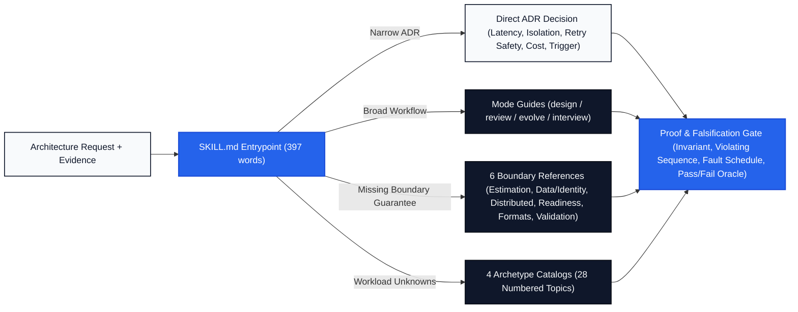

<p align="center">
  
</p>

# System Design Compass

A zero-dependency [Agent Skills](https://agentskills.io/specification) package that guides coding agents through production system design, architecture reviews, and migrations by naming the state invariant, constructing a concrete failure sequence, and specifying a pass/fail validation check.

[](https://agentskills.io/specification)
[](skills/system-design-compass/SKILL.md)
[](#measured-results-and-current-limits)
[](skills/system-design-compass/SKILL.md)
[](#repository-structure-and-runtime-boundary)
[](LICENSE)

[Quickstart](#quickstart-in-60-seconds) · [Why Compass](#why-compass-the-decision-lens) · [Routing architecture](#how-the-skill-routes-decisions) · [Workflow modes](#core-workflow-modes) · [Reference directory](#on-demand-reference-directory) · [Workload catalogs](#28-production-workload-archetypes) · [Project structure](#repository-structure-and-runtime-boundary) · [Evaluation evidence](#measured-results-and-current-limits) · [Verification and dev](#development-and-verification)

> [!IMPORTANT]
> **Version `1.1.0` benchmark status and evaluation scope**
>
> On the 397-word `1.1.0` entrypoint (`sha256: 56723ba749e5...`), all 8/8 core benchmark cases passed (`40/44` rubric checks, `0` critical violations, `0` unsafe outcomes) on `gemini-3.8-flash-medium` under tool-free blind grading. The full two-model release gate (`tools/check_acceptance.py`), the 8-case regression suite, and repeated hard-case confirmations remain open from the `rc.9` and `rc.10` cohorts. See [Measured results and current limits](#measured-results-and-current-limits) and the [evaluation report](evals/results/2026-10-01.md) for the exact scope boundary.

## Quickstart in 60 seconds

Install the skill from GitHub into your active workspace using the [`skills` CLI](https://github.com/vercel-labs/skills):

```bash
npx skills add Woffluon/system-design-compass
```

From a local repository checkout, install directly from the root:

```bash
npx skills add .
```

### Invoke the skill in your coding agent

When your coding agent supports named skills, trigger it directly with a concrete architectural scenario:

```text
$system-design-compass Review this service's retry and timeout boundaries.
Use repository evidence. Preserve sound decisions. Give the smallest
correction and one experiment that could falsify the recommendation.
```

<details>
<summary><strong>Global installation, multi-agent targeting, and configuration</strong></summary>

Install globally across your user profile:

```bash
npx skills add Woffluon/system-design-compass --global
```

Target specific coding agents non-interactively:

```bash
npx skills add Woffluon/system-design-compass \
  --skill system-design-compass \
  --agent claude-code codex cursor gemini-cli github-copilot opencode \
  --global --yes
```

The skill requires no environment variables, API keys, MCP servers, or runtime scripts. During installation, the `skills` CLI copies the package into each target agent's skill directory (`79` supported agent targets across `55` directories, verified in CI with `skills@1.5.26`). The skill responds in the user's language while keeping reference terminology in English.

</details>

## Why Compass: the decision lens

Architecture advice becomes actionable when it states where a guarantee is enforced, which event sequence breaks it, and what observable test would disprove it.

| Familiar advice | The decision worth resolving |
|---|---|
| "Add idempotency." | What scopes the operation identity within its issuer contract, where are effect and result committed atomically, and what happens after a crash? |
| "Use a queue." | Does completion capacity exceed retry-amplified demand after worker loss, and who intervenes when backlog age rises? |
| "Roll back the deployment." | Can old code still read and write new data safely, and which external or unreplicated effects are already irreversible? |
| "Shard for scale." | Which measured bottleneck requires partitioning, and does the key distribute real skewed traffic? |
| "Modernize the architecture." | Which concrete invariant is failing today, and which sound existing decisions should remain untouched? |

> [!TIP]
> **Failure boundaries to check in every review**
> - When a remote call times out, resolve the external outcome before retrying or issuing a compensating action.
> - When a queue buffers a traffic spike or worker outage, verify that completion capacity exceeds normal arrivals plus retries so the backlog drains.
> - Before relying on binary rollback, verify that old code can both read and write data produced by the new version.

## How the skill routes decisions

The 397-word [entrypoint](skills/system-design-compass/SKILL.md) routes requests by the unresolved decision. Narrow Architectural Decision Records (ADRs) use the supplied facts and the entrypoint alone unless a decision-changing guarantee is missing. Broader requests open one workflow guide and only the specific boundary or workload sections that apply.



When evidence conflicts or correctness guarantees are uncertain, the skill runs a four-step check before recommending a design:

1. Name the critical invariant and its authoritative state owner.
2. Construct a concrete violating event sequence such as a concurrency race, crash between effect and record, timeout ambiguity, stale lease holder, or conflicting migration write.
3. Compare credible options against the simplest baseline using repository facts, arithmetic checks, and primary documentation.
4. State the enforcement mechanism, operational downside, measurable reconsideration trigger, and a fault-injection test with an observable pass/fail criterion.

## Core workflow modes

| Mode | Example prompt | Deliverable |
|---|---|---|
| **Design** | "Design delivery semantics for customer webhook endpoints." | Authoritative ownership, state contracts, credible options, and explicit failure guarantees. |
| **Review** | "Assess this architecture's tail-latency and retry risks." | Repository evidence citations, concrete trigger, blast radius, smallest correction, and validation test. |
| **Evolve** | "Move this database while writers and old clients remain active." | Per-phase source of truth, version-guarded convergence evidence, cutover barrier, and rollback boundaries. |
| **Decide narrowly** | "Write an ADR for synchronous vs. queue-backed thumbnail rendering." | One scoped ADR covering latency, failure isolation, retry safety, cost drivers, and reconsideration triggers. |
| **Practice** | "Run a 45-minute system design interview for search autocomplete." | Time-boxed scoping, capacity estimation, deep dives, failure analysis, and structured rubric feedback. |

Pass the artifacts you have, such as source code, schemas, configuration, SLOs, incident timelines, or existing ADRs. The skill records missing evidence as an explicit unknown or conditional assumption and separates it from confirmed defects. Harnesses with automatic skill discovery can also trigger the skill from natural-language prompts, although the single-turn benchmark suite does not measure automatic activation accuracy.

## On-demand reference directory

The [entrypoint](skills/system-design-compass/SKILL.md) links directly to 14 reference files under `skills/system-design-compass/references/` (each capped at `2,500` words by `tools/validate_repo.py`). Agents search section headings and read only the section required by the active decision.

| Reference guide | When the agent loads it |
|---|---|
| [Design](skills/system-design-compass/references/design.md) · [Review](skills/system-design-compass/references/review.md) · [Evolution](skills/system-design-compass/references/evolve.md) | The task requires a full greenfield design, evidence-based audit, or phased migration workflow. |
| [Requirements and estimation](skills/system-design-compass/references/requirements-estimation.md) | SLOs, burst demand, retry amplification, or unit conversions drive capacity choices. |
| [Interfaces and data](skills/system-design-compass/references/interfaces-data.md) | Authorization, scoped retry identity, atomic effect/result, or external provider reconciliation is unresolved. |
| [Distributed systems](skills/system-design-compass/references/distributed-systems.md) | Queue backlog recovery, lease fencing, replication lag, sharding, or overload protection affects guarantees. |
| [Production readiness](skills/system-design-compass/references/production-readiness.md) | Disaster recovery drills, threat boundaries, observability signals, or cost drivers matter. |
| [Decision validation](skills/system-design-compass/references/decision-validation.md) | A proposed mechanism lacks a concrete fault schedule, pass/fail oracle, or owned repair path. |
| [Deliverables and diagrams](skills/system-design-compass/references/deliverables-diagrams.md) | The requester needs an ADR, RFC, migration phase table, or C4/sequence diagram. |
| [Interview](skills/system-design-compass/references/interview.md) | Mock interview facilitation or retrospective grading is explicitly requested. |

## 28 production workload archetypes

Organized into four domain catalogs under `skills/system-design-compass/references/`:

| Archetype catalog | Numbered topics (`1` to `28`) |
|---|---|
| [Foundations and platform](skills/system-design-compass/references/archetypes-foundations-platform.md) | `1` Scaling · `2` Estimation · `3` Rate limiting · `4` Consistent hashing · `5` Key-value store · `6` Unique IDs · `7` URL shortener · `8` Web crawler |
| [User-facing and realtime](skills/system-design-compass/references/archetypes-user-facing-realtime.md) | `9` News feed · `10` Chat · `11` Search autocomplete · `12` Video streaming · `13` Cloud file storage · `14` Maps/routing · `15` Proximity service · `16` Nearby friends |
| [Data and infrastructure](skills/system-design-compass/references/archetypes-data-infrastructure.md) | `17` Notification system · `18` Message queue · `19` Metrics/monitoring · `20` Ad click aggregation · `21` Distributed email · `22` S3-like object storage |
| [Transactional and financial](skills/system-design-compass/references/archetypes-transactional-financial.md) | `23` Hotel reservation · `24` Real-time gaming leaderboard · `25` Payment system · `26` Digital wallet · `27` Stock exchange · `28` Ride-sharing dispatch |

Each archetype entry lists the domain's failure modes, state invariants, and discriminating design questions so the agent can test a workload's actual bottlenecks.

## Repository structure and runtime boundary

The repository separates the distributable skill package ([Agent Skills specification](https://agentskills.io/specification)) from local evaluation and validation tooling:

```text
system-design-compass/
├── skills/system-design-compass/          # Distributable skill package (zero runtime dependencies)
│   ├── SKILL.md                           # 397-word routing entrypoint and proof obligations
│   ├── agents/openai.yaml                 # Optional agent UI metadata ($system-design-compass)
│   └── references/                        # 14 on-demand Markdown guides (<= 2,500 words each)
├── .agents/skills/system-design-compass/  # Workspace skill mirror verified by validate_repo.py
├── evals/                                 # Behavioral evaluation suites, protocol, and reports
│   ├── README.md                          # Blinded evaluation protocol and CLI reference
│   ├── cases.md                           # Human-readable release expectations for the 8 core cases
│   ├── benchmark.json                     # 8 core comparative evaluation fixtures and rubrics
│   ├── benchmark-hard.json                # 3 prospective hard-case extensions (wallet, queue, cutover)
│   ├── regression.json                    # 8 single-turn regression adaptations of cases.md
│   ├── acceptance-2026-10-01.md           # Prospective stage ledger and protocol amendments
│   └── results/                           # Published evaluation reports (2026-09-30, 2026-10-01)
├── tools/                                 # Python 3.12 stdlib validators, evaluation runners, and 37 unit tests
│   ├── validate_repo.py                   # Enforces repo invariants, link/anchor resolution, word caps, and mirror sync
│   ├── evaluate_skill.py                  # Isolated Codex CLI runner, blind packet builder, and grader prep
│   ├── evaluate_agy.py                    # Antigravity CLI fallback runner with trace normalization
│   ├── compare_evals.py                   # Unblinds, validates rubric coverage, and summarizes metrics
│   ├── check_acceptance.py                # Verifies multi-model coverage, repeated gains, and context reduction
│   └── test_*.py                          # 37 unit tests covering repo validation, grading, isolation, and acceptance
├── assets/                                # Square skill logos (SVG/PNG) and visual asset specifications
└── .github/workflows/validate.yml         # CI pipeline (repo invariants, unit tests, spec check, 79-agent smoke test)
```

## Measured results and current limits

The [evaluation report](evals/results/2026-10-01.md) separates behavioral quality, context loading proxies, and packaging checks across frozen skill snapshots (`original`, `rc.1` through `rc.10`, and the condensed `1.1.0` entrypoint).

| Measurement or cohort | Evidence recorded in repository | Scope and interpretation |
|---|---|---|
| **Entrypoint size: `594` -> `397` words** | `SKILL.md` reduced by `33.2%` (`450` words in `rc.9`, `469` in `rc.10`, `397` in `1.1.0`). | Meets the `<400` word target and the `500`-word hard limit in `validate_repo.py`. |
| **Current `1.1.0` candidate (`gemini-3.8-flash-medium`): `8/8` benchmark passed** | `40/44` rubric checks passed (`0` critical failures, `0` unsafe answers, `2,307` median read words, `1,052` words on `narrow-adr`). | Tool-free blind grading on the 8 core benchmark cases (`repeat 1`, `skill_digest: 56723ba...`). |
| **`rc.9` narrow-ADR read words (`3.6` / `3.8` Flash Medium)** | `1,248` -> `1,105` words (`-11.5%`) on `3.6`; `2,723` -> `789` words (`-71.0%`) on `3.8`. | Measures returned command-output words on paired narrow ADR runs as an approximate context proxy. |
| **`rc.9` full two-model comparison (`71` graded answers)** | `3.6` passed `6/8` core and `7/8` regression; `3.8` passed `7/8` core and `7/8` regression. | Did not pass the full two-model release gate (`check_acceptance.py`) due to webhook, wallet, and rollback omissions. |
| **`rc.10` early webhook gate (`469`-word snapshot)** | `0/2` candidate webhook answers passed all checks across `3.6` and `3.8` Flash Medium. | Stopped the full `rc.10` cohort early before the entrypoint was condensed to `397` words. |
| **Packaging and CLI installation (`skills@1.5.26`)** | `79` supported agent targets across `55` directories; `14/14` reference files match byte-for-byte. | Verifies package format compatibility and CLI discovery layout across all 79 target directories. |

> [!NOTE]
> **Evidence boundaries:** Read-word counts measure returned tool output naming `SKILL.md` or `references/*.md` as an approximate context proxy; provider token totals are reported separately in the evaluation tables. The [September 30 report](evals/results/2026-09-30.md) records the earlier Codex (`gpt-5.6-sol` / `gpt-5.6-luna`) cohort for its frozen snapshot.

## Development and verification

Useful contributions start with an anonymized architecture prompt, raw repository fixtures, a consequential failure path, and a verifiable check. Read [Contributing](CONTRIBUTING.md) for repository invariants and validation rules, [Security](SECURITY.md) for vulnerability reporting and trust boundaries, [Behavioral evaluation cases](evals/cases.md) for the 8 release scenarios, or the [Comparative evaluation protocol](evals/README.md) to run a blinded comparison.

### Verification commands

Run the verification suite from the repository root (requires Python `3.10+` and Node.js `20+`; CI runs on Python `3.12` and Node.js `24`):

```bash
python tools/validate_repo.py
python -m unittest discover -s tools -p 'test_*.py'
python -m pip install skills-ref==0.1.1
agentskills validate skills/system-design-compass
npx skills@1.5.26 add . --list
git diff --check
```

<details>
<summary><strong>Troubleshooting common setup and validation issues</strong></summary>

| Symptom or error | Cause | Resolution |
|---|---|---|
| `duplicate heading in <file>: <heading>` | `tools/validate_repo.py` enforces case-insensitive unique Markdown headings per file across the repository. | Rename repeated subheadings so every `#` through `######` heading in a single `.md` file is unique. |
| `unfinished placeholder in <file>` | A Markdown file contains bracketed placeholder markers or fix-me tokens. | Replace draft markers with verified prose before running `python tools/validate_repo.py`. |
| `broken local link` or `broken markdown anchor` | A relative Markdown link points to a missing file, escapes the repository root, or references a `#anchor` that does not match any heading slug in the target `.md` file. | Verify the target file path and check that the `#anchor` matches the target heading after lowercase and punctuation normalization. |
| `workspace mirror out of sync` | A file under `.agents/skills/system-design-compass/` differs from `skills/system-design-compass/`. | Copy the updated `.md` or `.yaml` file from `skills/system-design-compass/` into `.agents/skills/system-design-compass/`. |
| `agentskills: command not found` | The optional specification validator (`skills-ref`) is not installed in the active Python environment. | Run `python -m pip install skills-ref==0.1.1` (development dependency only; not needed to use the skill). |
| PowerShell multiline `\` syntax error | Bash line continuations (`\`) in documentation examples are pasted directly into Windows PowerShell. | Join multiline arguments onto a single line or replace `\` with the PowerShell backtick (`` ` ``). |

</details>

## Sources and license

The 28-topic archetype catalog was inspired by the topic list in [`liquidslr/system-design-notes`](https://github.com/liquidslr/system-design-notes), which does not declare a redistribution license and notes that its material draws on commercial books. No prose, diagrams, tables, or images from that repository are included here.

All guidance is written independently from engineering first principles and primary sources: [AWS Well-Architected](https://docs.aws.amazon.com/wellarchitected/latest/framework/welcome.html), [Azure Well-Architected](https://learn.microsoft.com/azure/well-architected/), [Google Cloud Architecture Framework](https://cloud.google.com/architecture/framework), [Google SRE Books](https://sre.google/books/), [OWASP Threat Modeling Cheat Sheet](https://cheatsheetseries.owasp.org/cheatsheets/Threat_Modeling_Cheat_Sheet.html), and the [C4 model](https://c4model.com/).

Original repository content is released under the [MIT License](LICENSE). See [Visual asset specifications](assets/README.md) for logo geometry, color palette, and artwork provenance.
