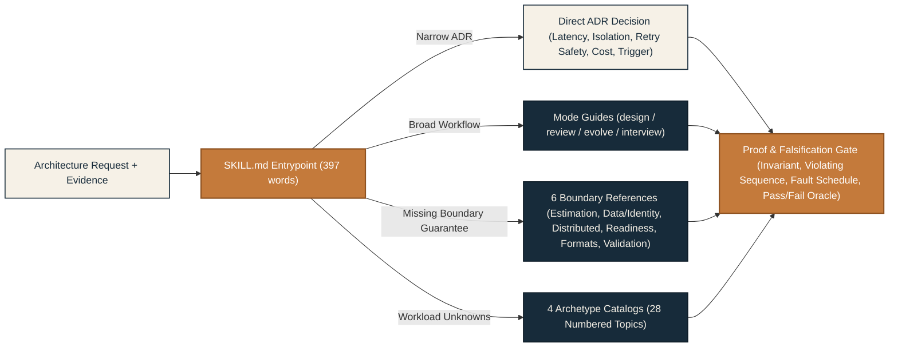

# System Design Compass

### Architecture decisions that survive the failure path.


[](https://agentskills.io)
[](skills/system-design-compass/SKILL.md)
[](#measured-results-and-current-limits)
[](skills/system-design-compass/SKILL.md)
[](#repository-structure-and-runtime-boundary)
[](LICENSE)

Give your coding agent a disciplined way to reason about **system design, architecture reviews, and safe migrations**. Instead of hand-waving abstractions, start with the unresolved decision, name the invariant and authoritative state owner, construct a concrete violating failure sequence, and prove which option is simplest and defensible.

**Compact 397-word entrypoint · On-demand selective reference loading · Zero runtime dependencies**

[Quickstart](#quickstart-in-60-seconds) · [Why Compass](#why-compass-the-decision-lens) · [Routing Architecture](#how-the-skill-routes-decisions) · [Workflow Modes](#core-workflow-modes) · [Reference Directory](#on-demand-reference-directory) · [Workload Catalogs](#28-production-workload-archetypes) · [Project Structure](#repository-structure-and-runtime-boundary) · [Evaluation Evidence](#measured-results-and-current-limits) · [Verification & Dev](#development-and-verification)

> [!IMPORTANT]
> **Version `1.1.0` benchmark status and evaluation scope**
>
> On the current 397-word `1.1.0` entrypoint (`sha256: 56723ba749e5...`), all **8/8 core benchmark cases passed** (`40/44` rubric checks, `0` critical violations, `0` unsafe outcomes) on `gemini-3.8-flash-medium` under tool-free blind grading. The strict two-model release gate across both Flash versions, the 8-case regression suite, and repeated hard-case confirmations remain open from the `rc.9`/`rc.10` cohort. Read [Measured results and current limits](#measured-results-and-current-limits) and the [evaluation report](evals/results/2026-10-01.md) for the exact scope boundary.

---

## Quickstart in 60 seconds

Install the skill from GitHub into your active workspace using the [`skills` CLI](https://github.com/vercel-labs/skills):

```bash
npx skills add Woffluon/system-design-compass
```

From a local repository checkout, install directly from the root:

```bash
npx skills add .
```

### Invoke the skill in your coding agent

When your coding agent supports named skills, trigger it directly with a concrete architectural scenario:

```text
$system-design-compass Review this service's retry and timeout boundaries.
Use repository evidence. Preserve sound decisions. Give the smallest
correction and one experiment that could falsify the recommendation.
```

<details>
<summary><strong>Global installation, multi-agent targeting, and configuration</strong></summary>

Install globally across your user profile:

```bash
npx skills add Woffluon/system-design-compass --global
```

Target specific coding agents non-interactively:

```bash
npx skills add Woffluon/system-design-compass \
  --skill system-design-compass \
  --agent claude-code codex cursor gemini-cli github-copilot opencode \
  --global --yes
```

**Configuration and environment:**
- **Skill runtime:** Requires **no environment variables, API keys, MCP servers, or runtime scripts**.
- **Agent discovery:** The `skills` CLI maps the package into each supported agent's directory (`79` target agents across `55` directories verified in CI with `skills@1.5.26`).
- **Response language:** The skill responds in the user's language while maintaining English reference terminology.

</details>

---

## Why Compass: the decision lens

Architecture advice becomes actionable when it states **where a guarantee is enforced**, **which event sequence breaks it**, and **what observable test would disprove it**.

| Familiar advice | The decision worth resolving |
|---|---|
| "Add idempotency." | What scopes the operation identity within its issuer contract, where are effect and result committed atomically, and what happens after a crash? |
| "Use a queue." | Does completion capacity exceed retry-amplified demand after worker loss, and who intervenes when backlog age rises? |
| "Roll back the deployment." | Can old code still read and write new data safely, and which external or unreplicated effects are already irreversible? |
| "Shard for scale." | Which measured bottleneck requires partitioning, and does the key distribute real skewed traffic? |
| "Modernize the architecture." | Which concrete invariant is failing today, and which sound existing decisions should remain untouched? |

> [!TIP]
> **Three reminders to bring into every architecture review:**
> - **A timeout is an unknown outcome.** Never treat an ambiguous remote call as a clean failure before resolving external state.
> - **Queue storage is not recovery capacity.** Backlog clearance requires net positive completion headroom above normal arrivals plus retries.
> - **Restoring old binaries does not undo incompatible writes.** Rollback safety depends on mixed-version read and write compatibility.

---

## How the skill routes decisions

Instead of loading a monolithic prompt on every turn, the [entrypoint](skills/system-design-compass/SKILL.md) routes by the unresolved decision. Narrow Architectural Decision Records (ADRs) stay inside the 397-word entrypoint unless a decision-changing guarantee is missing; broader work loads one workflow mode and only the specific boundary or workload sections needed.



When evidence conflicts or correctness guarantees are uncertain, the skill enforces a four-step proof loop before committing to a recommendation:

1. **Narrow the decision:** Name the critical invariant and its authoritative state owner.
2. **Break the proposal:** Construct a concrete violating sequence (concurrency race, crash between effect and record, timeout ambiguity, stale lease holder, or conflicting migration write).
3. **Compare against the simple baseline:** Evaluate credible options using repository facts, arithmetic checks, and primary documentation.
4. **Define the validation oracle:** Specify the enforcement boundary, operational downside, measurable reconsideration trigger, and a fault-injection test with a pass/fail business oracle.

---

## Core workflow modes

| Mode | Example prompt | Deliverable |
|---|---|---|
| **Design** | "Design delivery semantics for customer webhook endpoints." | Authoritative ownership, state contracts, credible options, and explicit failure guarantees. |
| **Review** | "Assess this architecture's tail-latency and retry risks." | Repository evidence citations, concrete trigger, blast radius, smallest correction, and validation test. |
| **Evolve** | "Move this database while writers and old clients remain active." | Per-phase source of truth, version-guarded convergence evidence, cutover barrier, and rollback boundaries. |
| **Decide narrowly** | "Write an ADR for synchronous vs. queue-backed thumbnail rendering." | One scoped ADR covering latency, failure isolation, retry safety, cost drivers, and reconsideration triggers. |
| **Practice** | "Run a 45-minute system design interview for search autocomplete." | Time-boxed scoping, capacity estimation, deep dives, failure analysis, and structured rubric feedback. |

Supply the artifacts you have: source code, schemas, configuration, SLOs, incident timelines, or existing ADRs. Missing evidence is treated as an explicit unknown or conditional assumption rather than a fabricated defect. Natural-language requests can activate the skill in harnesses that support automatic discovery, though automatic activation accuracy is not claimed by the single-turn benchmark suite.

---

## On-demand reference directory

The [entrypoint](skills/system-design-compass/SKILL.md) links directly to 14 reference files under `skills/system-design-compass/references/`. Agents search section headings and read only the material required by the active decision.

| Reference guide | When the agent loads it |
|---|---|
| [Design](skills/system-design-compass/references/design.md) · [Review](skills/system-design-compass/references/review.md) · [Evolution](skills/system-design-compass/references/evolve.md) | The task requires a full greenfield design, evidence-based audit, or phased migration workflow. |
| [Requirements and estimation](skills/system-design-compass/references/requirements-estimation.md) | SLOs, burst demand, retry amplification, or unit conversions drive capacity choices. |
| [Interfaces and data](skills/system-design-compass/references/interfaces-data.md) | Authorization, scoped retry identity, atomic effect/result, or external provider reconciliation is unresolved. |
| [Distributed systems](skills/system-design-compass/references/distributed-systems.md) | Queue backlog recovery, lease fencing, replication lag, sharding, or overload protection affects guarantees. |
| [Production readiness](skills/system-design-compass/references/production-readiness.md) | Disaster recovery drills, threat boundaries, observability signals, or cost drivers matter. |
| [Decision validation](skills/system-design-compass/references/decision-validation.md) | A proposed mechanism lacks a concrete fault schedule, pass/fail oracle, or owned repair path. |
| [Deliverables and diagrams](skills/system-design-compass/references/deliverables-diagrams.md) | The requester needs an ADR, RFC, migration phase table, or C4/sequence diagram. |
| [Interview](skills/system-design-compass/references/interview.md) | Mock interview facilitation or retrospective grading is explicitly requested. |

---

## 28 production workload archetypes

Organized into four domain catalogs under `skills/system-design-compass/references/`:

| Archetype catalog | Numbered topics (`1` to `28`) |
|---|---|
| [Foundations and platform](skills/system-design-compass/references/archetypes-foundations-platform.md) | `1` Scaling · `2` Estimation · `3` Rate limiting · `4` Consistent hashing · `5` Key-value store · `6` Unique IDs · `7` URL shortener · `8` Web crawler |
| [User-facing and realtime](skills/system-design-compass/references/archetypes-user-facing-realtime.md) | `9` News feed · `10` Chat · `11` Search autocomplete · `12` Video streaming · `13` Cloud file storage · `14` Maps/routing · `15` Proximity service · `16` Nearby friends |
| [Data and infrastructure](skills/system-design-compass/references/archetypes-data-infrastructure.md) | `17` Notification system · `18` Message queue · `19` Metrics/monitoring · `20` Ad click aggregation · `21` Distributed email · `22` S3-like object storage |
| [Transactional and financial](skills/system-design-compass/references/archetypes-transactional-financial.md) | `23` Hotel reservation · `24` Real-time gaming leaderboard · `25` Payment system · `26` Digital wallet · `27` Stock exchange · `28` Ride-sharing dispatch |

Catalogs expose failure modes, invariants, and discriminating questions; they are not prebuilt templates or mandatory vendor stacks.

---

## Repository structure and runtime boundary

The repository cleanly separates the **distributable skill package** (which follows the [Agent Skills specification](https://agentskills.io/specification)) from **development and evaluation tooling**:

```text
system-design-compass/
├── skills/system-design-compass/      # Distributable skill package (zero runtime dependencies)
│   ├── SKILL.md                       # 397-word routing entrypoint and proof obligations
│   ├── agents/openai.yaml             # Optional agent UI metadata ($system-design-compass)
│   └── references/                    # 14 on-demand Markdown guides (modes, boundaries, 28 archetypes)
├── evals/                             # Behavioral evaluation suites, protocol, and historical reports
│   ├── README.md                      # Blinded evaluation protocol and CLI reference
│   ├── cases.md                       # Human-readable release expectations for the 8 core cases
│   ├── benchmark.json                 # 8 core comparative evaluation fixtures and rubrics
│   ├── benchmark-hard.json            # 3 prospective hard-case extensions (wallet, queue, cutover)
│   ├── regression.json                # 8 single-turn regression adaptations of cases.md
│   ├── acceptance-2026-10-01.md       # Prospective stage ledger and protocol amendments
│   └── results/                       # Published evaluation reports (2026-09-30, 2026-10-01)
├── tools/                             # Python 3.12 stdlib validators, evaluation runners, and 30 unit tests
│   ├── validate_repo.py               # Enforces repo invariants, link integrity, and 500-word cap
│   ├── evaluate_skill.py              # Isolated Codex CLI runner, blind packet builder, and grader prep
│   ├── evaluate_agy.py                # Antigravity CLI fallback runner with trace normalization
│   ├── compare_evals.py               # Unblinds, validates rubric coverage, and summarizes metrics
│   ├── check_acceptance.py            # Verifies multi-model coverage, repeated gains, and context reduction
│   └── test_*.py                      # 30 unit tests covering grading, isolation, and acceptance logic
├── assets/                            # Repository cover illustration and generation provenance
└── .github/workflows/validate.yml     # CI pipeline (repo invariants, unit tests, spec check, 79-agent smoke test)
```

---

## Measured results and current limits

The [evaluation report](evals/results/2026-10-01.md) separates behavioral quality, context loading proxies, and packaging checks across frozen skill snapshots (`original`, `rc.1` through `rc.10`, and the condensed `1.1.0` entrypoint).

| Measurement or cohort | Evidence recorded in repository | Scope and interpretation |
|---|---|---|
| **Entrypoint size: `594` -> `397` words** | `SKILL.md` reduced by `33.2%` (`450` words in `rc.9`, `469` in `rc.10`, `397` in `1.1.0`). | Meets the `<400` word target and the `500`-word hard limit in `validate_repo.py`. |
| **Current `1.1.0` candidate (`gemini-3.8-flash-medium`): `8/8` benchmark passed** | `40/44` rubric checks passed (`0` critical failures, `0` unsafe answers, `2,307` median read words, `1,052` words on `narrow-adr`). | Tool-free blind grading on the 8 core benchmark cases (`repeat 1`, `skill_digest: 56723ba...`). |
| **`rc.9` narrow-ADR read words (`3.6` / `3.8` Flash Medium)** | `1,248` -> `1,105` words (`-11.5%`) on `3.6`; `2,723` -> `789` words (`-71.0%`) on `3.8`. | Approximate command-output proxy on paired narrow ADR runs, not billing token savings. |
| **`rc.9` full two-model comparison (`71` graded answers)** | `3.6` passed `6/8` core and `7/8` regression; `3.8` passed `7/8` core and `7/8` regression. | Complete two-model release gate (`check_acceptance.py`) was **not passed** due to webhook, wallet, and rollback gaps. |
| **`rc.10` early webhook gate (`469`-word snapshot)** | `0/2` candidate webhook answers passed all checks across `3.6` and `3.8` Flash Medium. | Stopped the full `rc.10` cohort early before the entrypoint was condensed to `397` words. |
| **Packaging & CLI installation (`skills@1.5.26`)** | `79` supported agent targets across `55` directories; `14/14` reference files match byte-for-byte. | Confirms format compatibility and CLI discovery, not model behavior across all 79 harnesses. |

> [!NOTE]
> **Evidence boundaries:** Read-word counts measure returned tool output naming `SKILL.md` or `references/*.md`; they are context proxies rather than tokenizer counts. The [September 30 report](evals/results/2026-09-30.md) documents the earlier Codex (`gpt-5.6-sol` / `gpt-5.6-luna`) cohort and remains historical evidence for its frozen snapshot.

---

## Development and verification

Useful contributions start with an anonymized architecture prompt, raw repository fixtures, a consequential failure path, and a verifiable check. Read [Contributing](CONTRIBUTING.md) for repository invariants and validation rules, [Security](SECURITY.md) for vulnerability reporting and trust boundaries, [Behavioral evaluation cases](evals/cases.md) for the 8 release scenarios, or the [Comparative evaluation protocol](evals/README.md) to run a blinded comparison.

### Verification commands

Run the full verification suite from the repository root (requires Python `3.10+` and Node.js `20+`; CI runs on Python `3.12` and Node.js `24`):

```bash
python tools/validate_repo.py
python -m unittest discover -s tools -p 'test_*.py'
python -m pip install skills-ref==0.1.1
agentskills validate skills/system-design-compass
npx skills@1.5.26 add . --list
git diff --check
```

<details>
<summary><strong>Troubleshooting common setup and validation issues</strong></summary>

| Symptom or error | Cause | Resolution |
|---|---|---|
| `duplicate heading in <file>: <heading>` | `tools/validate_repo.py` enforces case-insensitive unique Markdown headings per file across the repository. | Rename repeated subheadings so every `#` through `######` heading in a single `.md` file is unique. |
| `unfinished placeholder in <file>` | A Markdown file contains bracketed placeholder markers or fix-me tokens. | Replace draft markers with verified prose before running `python tools/validate_repo.py`. |
| `broken local link in <file>` | A relative Markdown link points to a missing file or escapes the repository root. | Verify the target path relative to the Markdown file's parent directory. |
| `agentskills: command not found` | The optional specification validator (`skills-ref`) is not installed in the active Python environment. | Run `python -m pip install skills-ref==0.1.1` (development dependency only; not needed to use the skill). |
| PowerShell multiline `\` syntax error | Bash line continuations (`\`) in documentation examples are pasted directly into Windows PowerShell. | Join multiline arguments onto a single line or replace `\` with the PowerShell backtick (`` ` ``). |

</details>

---

## Sources and license

The 28-topic archetype catalog was inspired by the topic list in [`liquidslr/system-design-notes`](https://github.com/liquidslr/system-design-notes), which does not declare a redistribution license and notes that its material draws on commercial books. No prose, diagrams, tables, or images from that repository are included here.

All guidance is written independently from engineering first principles and primary sources: [AWS Well-Architected](https://docs.aws.amazon.com/wellarchitected/latest/framework/welcome.html), [Azure Well-Architected](https://learn.microsoft.com/azure/well-architected/), [Google Cloud Architecture Framework](https://cloud.google.com/architecture/framework), [Google SRE Books](https://sre.google/books/), [OWASP Threat Modeling Cheat Sheet](https://cheatsheetseries.owasp.org/cheatsheets/Threat_Modeling_Cheat_Sheet.html), and the [C4 model](https://c4model.com/).

Original repository content is released under the [MIT License](LICENSE). [Cover art provenance and generation prompt](assets/README.md) are documented alongside the image asset.
