# Comparative evaluation

Measure architecture decisions and context loading together. Compare frozen skill snapshots in equivalent isolated sessions, grade answers without condition or model labels, and keep failed, timed-out, or contaminated attempts visible.

[Pipeline](#evaluation-and-blind-grading-pipeline) · [Suites & cases](#choose-the-cases) · [Isolation rules](#establish-isolation-before-a-batch) · [Record subjects](#record-subjects) · [Blind grading](#grade-without-condition-labels) · [Release gate](#apply-the-release-gate) · [CLI & status reference](#cli-reference-and-status-codes) · [Troubleshooting](#troubleshooting-evaluation-runs)

> [!IMPORTANT]
> **Published evaluation records:**
> - [2026-10-01 follow-up report](results/2026-10-01.md) and [machine-readable archive](results/2026-10-01.json) cover the `rc.1` through `rc.10` cohorts and the current 397-word `1.1.0` candidate benchmark on `gemini-3.8-flash-medium`.
> - [Prospective protocol and stage ledger](acceptance-2026-10-01.md) documents every budget ceiling and protocol amendment in chronological order.
> - [2026-09-30 baseline report](results/2026-09-30.md) and [machine-readable record](results/2026-09-30.json) remain historical evidence for the initial snapshot.

## Evaluation and blind grading pipeline

The evaluation tools in [`tools/`](../tools/) separate subject execution, anonymization, grading, and acceptance verification:

```mermaid
flowchart LR
    classDef navy fill:#0f172a,stroke:#090d16,color:#f8fafc,stroke-width:1.5px
    classDef cobalt fill:#2563eb,stroke:#1d4ed8,color:#ffffff,stroke-width:2px
    classDef slate fill:#f8fafc,stroke:#0f172a,color:#0f172a,stroke-width:1.5px

    Snap["1. evaluate_skill.py snapshot\nFreeze skill + SHA-256"]:::slate --> Run["2. evaluate_skill.py run / evaluate_agy.py\nIsolated subject runs (none / current / candidate)"]:::navy
    Run --> Blind["3. evaluate_skill.py blind\nShuffle answers -> blind.json + key.json"]:::cobalt
    Blind --> Prep["4. evaluate_skill.py prepare-grading\nBuild tool-free batches -> grading.json"]:::navy
    Prep --> Grade["5. Grader run\nEvaluate checks -> grades.json"]:::navy
    Grade & Blind --> Comp["6. compare_evals.py\nUnblind, validate rubric -> comparison.json"]:::cobalt
    Comp --> Gate["7. check_acceptance.py\nVerify 2-model wins, regressions & context"]:::slate
```



## Choose the cases

| Suite file | Purpose | Case coverage |
|---|---|---|
| [benchmark.json](benchmark.json) | Compare `none`, `current` (original), and `candidate` conditions. | `8` cases (`44` checks): `webhook-effect`, `reservation-owner`, `retry-review`, `queue-recovery`, `backfill-convergence`, `rollback-contract`, `narrow-adr`, and `sound-system`. |
| [benchmark-hard.json](benchmark-hard.json) | Resolve a strong-model baseline ceiling with harder variants. | `3` cases (`18` checks): `wallet-retry-namespace`, `retry-stage-overload`, and `cutover-inflight-rollback`. Shares suite name `"benchmark"` so `check_acceptance.py` unions coverage (`11` cases). |
| [regression.json](regression.json) | Verify non-regression across core capabilities. | `8` single-turn adaptations of [cases.md](cases.md) (`37` checks): `ambiguous-greenfield`, `architecture-evidence`, `monolith-evolution`, `wallet-correctness`, `location-privacy`, `concise-adr`, `current-provider`, and `interview-retrospective`. |
| [cases.md](cases.md) | Human-readable specification of release expectations. | Required behaviors, critical invariants, and explicit unsafe-behavior disqualifiers. |

Rubrics score observable architectural mechanisms without requiring specific vendor names or buzzwords. The `interview-retrospective` case is a single-turn adaptation and does not measure live multi-turn dialogue.

Use one stronger and one smaller model from the same provider through existing authenticated access unless the user selects a different pair. Freeze model IDs, reasoning effort (`medium`), CLI versions, and skill snapshots before launching subjects. Never add paid API keys or subscriptions to force a run to succeed.

## Establish isolation before a batch

| Boundary | Required enforcement |
|---|---|
| Workspace | Fresh temporary directory (`compass-eval-*` or `compass-agy-*`) per attempt, containing no prior answers or expected solutions. |
| Evidence | Raw case fixtures and prompt only; scoring rubrics stay out of the subject workspace. |
| Skill snapshot | Explicit frozen copy at `workspace/skill/SKILL.md`; verify actual read commands in the JSONL trace. |
| Host configuration | Disable skill discovery, plugins, apps, hooks, memories, `AGENTS.md`, and skill search per invocation without editing global user files. |
| Permissions | Identical sandbox mode across all compared conditions (`none`, `current`, `candidate`). |
| Side effects | Compare workspace SHA-256 digests (`digest(workspace)`) before and after execution; exclude mutations (`workspace-mutated`) and foreign skill reads (`contaminated`). |

> [!WARNING]
> **Filesystem vs. configuration isolation:** CLI switches do not block an agent from reading an installed home-directory skill via shell commands. `tools/evaluate_skill.py` enumerates every `SKILL.md` under `~/.codex/skills` and `~/.agents/skills` via `disabled_host_skills()`, passes `enabled=false` per invocation, and audits normalized command paths (including escaped Windows paths). Any command touching `.codex/skills`, `.agents/skills`, or `.codex/plugins` (or `.gemini/`, `.agents/skills`, or `.codex/` in `evaluate_agy.py`) marks the record `contaminated`.

`read-only` execution is the default sandbox in [`tools/evaluate_skill.py`](../tools/evaluate_skill.py). Because some Windows hosts block child shell file reads in `read-only` mode, `--sandbox danger-full-access` may be passed explicitly for trusted authored fixtures when all compared conditions use the same setting. The runner never escalates permissions automatically after a sandbox rejection.

### Antigravity CLI fallback (`tools/evaluate_agy.py`)

[`tools/evaluate_agy.py`](../tools/evaluate_agy.py) records a separate provider cohort through existing `agy` CLI access (`protocol: agy-fresh-workspace-v1`). For each trial, it creates a temporary directory (`compass-agy-*`), writes a restricted workspace agent at `.agents/agents/sdc-subject.md`, starts a fresh project session (`--new-project --agent sdc-subject --effort medium --disable-slash-commands --dangerously-skip-permissions`), supplies raw fixtures both on disk and inline in the prompt (`fixtures_inline: True`), and writes native stream events (`<run_id>.native.jsonl`) alongside normalized command outputs (`<run_id>.jsonl`):

```bash
python tools/evaluate_agy.py --suite evals/benchmark.json \
  --models gemini-3.6-flash-medium gemini-3.8-flash-medium \
  --condition current --skill evals/artifacts/current \
  --output evals/artifacts/agy-original --limit 94
```

Subject runs use the `AGENT` profile in `.agents/agents/sdc-subject.md`, which restricts `tools` to `[run_command]` with `skills: []`, `plugins: []`, and `mcpServers: []`. Grading runs (`case.get("grading") == True`) use the `GRADER` profile with `tools: []`. Because Antigravity global rules and skill catalogs remain cumulative across sessions, `evaluate_agy.py` normalizes completed tool steps (`CommandLine` or serialized parameters) and scans them for `.gemini/`, `.agents/skills`, or `.codex/` paths, marking any foreign access `contaminated`. Common prefix token overhead is reported separately from observed skill-read words. Never pair Antigravity fallback subjects with Codex CLI baselines.

## Record subjects

Run commands from the repository root. Examples below use Bash `\` line continuations; in Windows PowerShell, place each command on one line or use `` ` ``. Replace `STRONG` and `SMALL` with verified model identifiers.

### 1. Freeze and measure the baseline

```bash
python tools/evaluate_skill.py snapshot --output evals/artifacts/current

python tools/evaluate_skill.py run \
  --suite evals/benchmark.json --models STRONG SMALL \
  --condition none --output evals/artifacts/runs

python tools/evaluate_skill.py run \
  --suite evals/benchmark.json --models STRONG SMALL \
  --condition current --skill evals/artifacts/current \
  --output evals/artifacts/runs
```

Inspect baseline failures and loading traces before editing skill content. Add guidance only to address an observed failure.

### 2. Freeze and measure the candidate

```bash
python tools/evaluate_skill.py snapshot --output evals/artifacts/candidate

python tools/evaluate_skill.py run \
  --suite evals/benchmark.json --models STRONG SMALL \
  --condition candidate --skill evals/artifacts/candidate \
  --output evals/artifacts/runs

python tools/evaluate_skill.py run \
  --suite evals/regression.json --models STRONG SMALL \
  --condition candidate --skill evals/artifacts/candidate \
  --output evals/artifacts/runs
```

Do not overwrite a frozen snapshot directory (`snapshot` raises `ValueError` if `--output` already exists). Every revised skill, fixture, or protocol setting requires a distinct snapshot digest and output record.

## Grade without condition labels

### 3. Build the blinded packet

```bash
python tools/evaluate_skill.py blind \
  --output evals/artifacts/runs \
  --packet evals/artifacts/blind.json --key evals/artifacts/key.json

python tools/evaluate_skill.py prepare-grading \
  --packet evals/artifacts/blind.json \
  --suites evals/benchmark.json evals/regression.json \
  --output evals/artifacts/grading.json --name grading-final
```

`blind` selects records where `status == "completed"` and `role != "grader"` (optionally filtered by `--conditions` and `--suites`), shuffles them deterministically with `random.Random(20260930)`, assigns sequential IDs (`answer-001`, `answer-002`, ...), attaches `verification_trace` entries from `<run_id>.jsonl` (`web_search` events and exit-0 `command_execution` events matching `Invoke-WebRequest`, `Invoke-RestMethod`, `curl`, `urlopen`, `urllib.request`, `requests.get`, or `fetch(` with non-empty output), and writes the run-ID mapping to `key.json`.

### 4. Run the blinded grader

```bash
python tools/evaluate_skill.py run \
  --suite evals/artifacts/grading.json --models STRONG \
  --condition none --output evals/artifacts/runs
```

Combine the resulting JSON arrays from each grader batch (`batch-1`, `batch-2`, ...) into `evals/artifacts/grades.json`. Every grade object must satisfy the schema enforced by `validate_grade` in [`tools/compare_evals.py`](../tools/compare_evals.py):

| Grade JSON field | Validation rule in `tools/compare_evals.py` |
|---|---|
| `id` | Matches the blinded `answer-NNN` ID; `grades.json` must cover `blind.json` 1:1 with no duplicates or gaps. |
| `checks` | Includes every rubric check ID for the case once, with `pass` (`bool`) and non-empty `evidence` (`str`). |
| `unsafe_behavior` | Explicit `bool`; `true` fails the case regardless of check score. |
| `unsupported_findings` | Explicit `list[str]` (use `[]` when none exist). |
| `unnecessary_components` | Explicit `list[str]` (use `[]` when none exist). |

### 5. Unblind, validate, and summarize

```bash
python tools/compare_evals.py \
  --packet evals/artifacts/blind.json --key evals/artifacts/key.json \
  --grades evals/artifacts/grades.json \
  --suites evals/benchmark.json evals/regression.json \
  --runs evals/artifacts/runs --output evals/artifacts/comparison.json
```

## Apply the release gate

A single case passes (`case_pass: true`) only when:
1. All critical checks pass (`critical_failures == []`),
2. At least 80% of all checks pass (`passed_checks >= math.ceil(0.8 * total_checks)`), and
3. No unsafe behavior occurs (`unsafe_behavior == False`).

Run [`tools/check_acceptance.py`](../tools/check_acceptance.py) to verify the multi-model release gate across baseline and candidate comparisons:

```bash
python tools/check_acceptance.py \
  --baseline evals/artifacts/baseline-comparison.json \
  --candidate evals/artifacts/candidate-comparison.json \
  --models STRONG SMALL --suites evals/benchmark.json evals/regression.json
```

| Gate enforced by `check_acceptance.py` | Exact code requirement |
|---|---|
| Complete baseline coverage | Both `none` and `current` conditions must have 1 record per `benchmark` case for every model (`len(cases) == len(expected["benchmark"])` with no missing or duplicate cases). |
| Complete candidate coverage | `candidate` condition must cover every case ID in all supplied suites (`benchmark` and `regression`). |
| Zero candidate case failures | Every `candidate` record across all repeats and suites must have `grade["case_pass"] == True`. |
| Repeated hard-case improvement | For each model, at least one hard benchmark case (`expected["benchmark"] - {"narrow-adr", "sound-system"}`) that failed in `current` must pass in `candidate` across at least 3 distinct `repeat` values. |
| Narrow-task context reduction | For each model, `candidate` must contain 1 `benchmark/narrow-adr` record (`len(narrow) == 1`) with strictly fewer `observed_skill_read_output_words` than `current`. |

## CLI reference and status codes

### Command-line tools (`tools/*.py`)

| Script & subcommand | Arguments and defaults | Purpose |
|---|---|---|
| `evaluate_skill.py snapshot` | `--source` (`skills/system-design-compass`), `--output` (required) | Copies the skill directory to a new target path and prints the SHA-256 digest of relative POSIX paths and raw file bytes. |
| `evaluate_skill.py run` | `--suite` (required), `--models` (`+`, required), `--condition` (`none\|current\|candidate`, required), `--skill` (required for `current\|candidate`), `--output` (required), `--base-url`, `--effort` (`low\|medium\|high`, default `medium`), `--workers` (`1..4`, default `2`), `--timeout` (`600`), `--repeat` (`1`), `--limit` (`94`), `--sandbox` (`read-only\|danger-full-access`, default `read-only`), `--cases` (`+`), `--inline-fixtures` (flag), `--retain-source-content` (flag) | Runs isolated Codex CLI turns (`protocol: isolated-catalog-v3`) under a file lock (`run.lock`) and per-directory trial cap. |
| `evaluate_skill.py blind` | `--output` (required), `--packet` (required), `--key` (required), `--conditions` (`+`), `--suites` (`+`) | Filters completed non-grader records, shuffles with seed `20260930`, attaches `verification_trace`, and writes `blind.json` and `key.json`. |
| `evaluate_skill.py prepare-grading` | `--packet` (required), `--suites` (`+`, required), `--output` (required), `--name` (required), `--batch-size` (`1..32`, default `2`) | Groups blinded answers by `(suite, case)` and builds tool-free grader batch definitions (`batch-1`, `batch-2`, ...). |
| `evaluate_agy.py` | `--suite` (required), `--models` (`+`, required), `--condition` (`none\|current\|candidate`, required), `--skill` (required for `current\|candidate`), `--output` (required), `--cases` (`+`), `--repeat` (`1`), `--workers` (`1..4`, default `2`), `--timeout` (`600`), `--limit` (`94`) | Runs Antigravity CLI turns (`protocol: agy-fresh-workspace-v1`) with pinned `--effort medium`, inline fixtures, `.agents/agents/sdc-subject.md`, and a `RESOURCE_EXHAUSTED` circuit breaker. |
| `compare_evals.py` | `--packet` (required), `--key` (required), `--grades` (required), `--suites` (`+`, required), `--runs` (required), `--output` (required) | Resolves run records via `safe_path`, verifies answer immutability and 1:1 grade coverage, computes `case_pass`, and prints cohort summaries. |
| `check_acceptance.py` | `--baseline` (required), `--candidate` (required), `--models` (`+`, required), `--suites` (`+`, required) | Verifies the five release-gate conditions across all requested models and suites, exiting non-zero on any failure. |

### Recorded run status values

| Status value | Meaning and trigger in `evaluate_skill.py` / `evaluate_agy.py` | Eligible for `blind`? |
|---|---|---|
| `reserved` | Placeholder written before launching the CLI worker pool to enforce `--limit`. | No |
| `completed` | Process exited `0`, turn completed (`turn.completed` in Codex or native `result.status == "SUCCESS"` in Antigravity), answer is non-empty, and all post-run audits passed. | Yes |
| `failed` | Non-zero exit code, empty answer, missing completion event, or native terminal `ERROR` (such as HTTP `503 UNAVAILABLE`, with error details stored in `terminal_error` and `provider_error`). | No |
| `timeout` | Subprocess exceeded `--timeout` in `evaluate_skill.py` or `--timeout + 30` seconds in `evaluate_agy.py`. | No |
| `contaminated` | Command trace accessed a foreign skill/config path (`other_skill_commands` non-empty) or read `SKILL.md` / `references/*.md` under `--condition none`. | No |
| `unverified-skill-load` | Condition was `current` or `candidate`, but `SKILL.md` was absent from `observed_skill_reads` (checked on all runs in `evaluate_skill.py` and on `completed` runs in `evaluate_agy.py`). | No |
| `unverified-fixture-access` | Case included disk `files` without `--inline-fixtures`, and `command_count == 0` (`evaluate_skill.py` only; `evaluate_agy.py` always sets `fixtures_inline: True`). | No |
| `workspace-mutated` | Temporary workspace SHA-256 `digest(workspace)` changed during execution because the subject created or modified files. | No |
| `quota-exhausted` | `evaluate_agy.py` observed `RESOURCE_EXHAUSTED` in `provider_error["status"]` (parsed from `AGY_ERROR:` on stderr) or in `terminal_error`, tripping the `exhausted` circuit breaker (`threading.Event`). | No |
| `not-started-quota-exhausted` | Queued job skipped (`launched: False`) in `evaluate_agy.py` after an earlier worker set the `exhausted` event. | No |
| `unverified-model` | `evaluate_agy.py` completed a turn whose native `init.model` (`observed_model`) did not match the requested `--model`. | No |
| `unverified-grader-isolation` | `evaluate_agy.py` ran a grading batch (`case.get("grading") == True`) that recorded `command_count > 0` despite `tools: []`. | No |

## Interpret the measurements

| Metric | What it measures | Known boundary |
|---|---|---|
| `input_tokens`, `output_tokens`, `cached_input_tokens` | Group sums computed by `compare_evals.py` when every record in a `(suite, model, condition, repeat)` group reports `usage` (`None` if any record lacks usage). `evaluate_agy.py` maps native `cache_read_tokens` to `cached_input_tokens` and retains `thinking_tokens` on individual run records. | Counts include harness system prompts and repeated multi-turn prefixes in addition to skill content. |
| `observed_skill_read_output_words` | Whitespace word count of exit-0 command outputs matching `SKILL.md` or `references/*.md` (excluding directory listings such as `rg --files` or `Get-ChildItem` without content reads). | Approximate context proxy: mixed shell commands can overcount, and indirect reads via variables can go unobserved. |
| `observed_reference_count` & `repeated_skill_reads` | Distinct `references/*.md` paths in `observed_skill_reads` and total reread count (`len(reads) - len(set(reads))`). | A heading search (`rg '^##'`) followed by a targeted section read counts as two reads of the same file; inspect `<run_id>.jsonl` before treating rereads as waste. |
| `case_pass` & `critical_failures` | Rubric grading outcomes computed by `validate_grade` in `compare_evals.py`. | Model-assisted grading is fallible; audit decisive passes and failures against raw answers and retain initial scores. |

## Troubleshooting evaluation runs

| Issue | Root cause | Fix |
|---|---|---|
| `FileExistsError: .../run.lock` | Another recorder instance is active or a previous process terminated before its `finally` block removed `run.lock`. | Confirm no `evaluate_skill.py` or `evaluate_agy.py` process is running, then delete the stale `run.lock` file in the output directory. |
| `run cap exceeded` / `trial cap exceeded` | Existing `*.json` files in `--output` plus newly requested jobs exceed `--limit` (default `94`). | Pass an explicitly authorized `--limit` ceiling or use a separate stage directory; never delete failed or contaminated records to free budget slots. |
| Subjects end with `unverified-fixture-access` on Windows | Windows `read-only` sandbox blocked child shell commands from reading workspace files. | Re-run in a new output directory using `--sandbox danger-full-access` across all compared conditions on trusted fixtures, or pass `--inline-fixtures`. |
| `ValueError: grades must cover the blind packet exactly once` | A grader batch truncated its JSON output or omitted an `answer-NNN` entry when assembling `grades.json`. | Re-run only the incomplete grader batch (`--cases batch-N --repeat 2`), preserve the failed batch record, and merge the complete JSON array. |
| `quota-exhausted` or `503 UNAVAILABLE` during `evaluate_agy.py` | Provider returned `RESOURCE_EXHAUSTED` (tripping the in-process `exhausted` event) or a native terminal `ERROR`, or the account fell to or below the `50%` protocol quota guard. | Check remaining quota via interactive `/usage` in the `agy` CLI (`agy usage` and `--usage` are unsupported on the command line) and stop new launches when either Gemini window is at or below `50%`. |

## Method references

- Structured trace evaluation approach: [OpenAI Skill Evaluation Guide](https://developers.openai.com/blog/eval-skills)
- Per-invocation Codex configuration flags: [Codex Configuration Reference](https://learn.chatgpt.com/docs/config-file/config-reference)
- Antigravity workspace skills, rules, and quota panel: [Antigravity Skills Docs](https://www.antigravity.google/docs/skills?tab=ide), [Rules Docs](https://www.antigravity.google/docs/rules/), and [Usage Command Docs](https://www.antigravity.google/docs/cli/commands/usage/)
