# Comparative evaluation

**Measure architecture decisions and context loading together.** Compare frozen skill snapshots in equivalent isolated sessions, grade answers without condition or model labels, and keep failed, timed-out, or contaminated attempts visible.

[Pipeline](#evaluation-and-blind-grading-pipeline) · [Suites & cases](#choose-the-cases) · [Isolation rules](#establish-isolation-before-a-batch) · [Record subjects](#record-subjects) · [Blind grading](#grade-without-condition-labels) · [Release gate](#apply-the-release-gate) · [CLI & status reference](#cli-reference-and-status-codes) · [Troubleshooting](#troubleshooting-evaluation-runs)

> [!IMPORTANT]
> **Published evaluation records:**
> - [2026-10-01 follow-up report](results/2026-10-01.md) and [machine-readable archive](results/2026-10-01.json) cover the `rc.1` through `rc.10` cohorts and the current 397-word `1.1.0` candidate benchmark on `gemini-3.8-flash-medium`.
> - [Prospective protocol and stage ledger](acceptance-2026-10-01.md) documents every budget ceiling and protocol amendment in chronological order.
> - [2026-09-30 baseline report](results/2026-09-30.md) and [machine-readable record](results/2026-09-30.json) remain historical evidence for the initial snapshot.

## Evaluation and blind grading pipeline

The evaluation tools in [`tools/`](../tools/) enforce a strict separation between subject execution, anonymization, grading, and acceptance verification:

```mermaid
flowchart LR
    classDef navy fill:#172b3a,stroke:#0d1b26,color:#f6f1e7,stroke-width:1.5px
    classDef copper fill:#c47a3b,stroke:#8f5322,color:#ffffff,stroke-width:2px
    classDef slate fill:#f6f1e7,stroke:#172b3a,color:#172b3a,stroke-width:1.5px

    Snap["1. evaluate_skill.py snapshot\nFreeze skill + SHA-256"]:::slate --> Run["2. evaluate_skill.py run / evaluate_agy.py\nIsolated subject runs (none / current / candidate)"]:::navy
    Run --> Blind["3. evaluate_skill.py blind\nShuffle answers -> blind.json + key.json"]:::copper
    Blind --> Prep["4. evaluate_skill.py prepare-grading\nBuild tool-free batches -> grading.json"]:::navy
    Prep --> Grade["5. Grader run\nEvaluate checks -> grades.json"]:::navy
    Grade & Blind --> Comp["6. compare_evals.py\nUnblind, validate rubric -> comparison.json"]:::copper
    Comp --> Gate["7. check_acceptance.py\nVerify 2-model wins, regressions & context"]:::slate
```



## Choose the cases

| Suite file | Purpose | Case coverage |
|---|---|---|
| [benchmark.json](benchmark.json) | Compare `none`, `current` (original), and `candidate` conditions. | `8` cases: `reservation-owner`, `webhook-effect`, `queue-recovery`, `backfill-convergence`, `rollback-contract`, `sound-system`, `narrow-adr`, and `retry-review`. |
| [benchmark-hard.json](benchmark-hard.json) | Resolve a strong-model baseline ceiling with harder variants. | `3` cases: `wallet-retry-namespace`, `queue-poison-amplification`, and `cutover-in-flight-divergence`. Shares suite name `"benchmark"` so `check_acceptance.py` unions coverage (`11` cases). |
| [regression.json](regression.json) | Verify non-regression across core capabilities. | `8` single-turn adaptations of [cases.md](cases.md): `ambiguous-greenfield`, `architecture-evidence`, `monolith-evolution`, `wallet-correctness`, `location-privacy`, `concise-adr`, `current-provider`, and `interview-retrospective`. |
| [cases.md](cases.md) | Human-readable specification of release expectations. | Required behaviors, **critical** invariants, and explicit **unsafe behavior** disqualifiers. |

Rubrics score observable architectural mechanisms, not buzzwords or required vendor names. Note that `interview-retrospective` is a single-turn adaptation and does not measure live multi-turn dialogue.

Use one stronger and one smaller model from the same provider through existing authenticated access unless the user explicitly selects a different pair. Freeze model IDs, reasoning effort (`medium`), CLI versions, and skill snapshots before launching subjects. Never add paid API keys or subscriptions to force a run to succeed.

## Establish isolation before a batch

| Boundary | Required enforcement |
|---|---|
| **Workspace** | Fresh temporary directory (`compass-eval-*` or `compass-agy-*`) per attempt; no prior answers or expected solutions. |
| **Evidence** | Raw case fixtures and prompt only; scoring rubrics never enter the subject workspace. |
| **Skill snapshot** | Explicit frozen copy at `workspace/skill/SKILL.md`; verify actual read commands in the JSONL trace. |
| **Host configuration** | Disable skill discovery, plugins, apps, hooks, memories, `AGENTS.md`, and skill search per invocation without mutating global user files. |
| **Permissions** | Identical sandbox mode across all compared conditions (`none`, `current`, `candidate`). |
| **Side effects** | Compare workspace SHA-256 digests before and after execution; exclude mutations (`workspace-mutated`) and foreign skill reads (`contaminated`). |

> [!WARNING]
> **Filesystem vs. configuration isolation:** CLI switches do **not** block an agent from reading an installed home-directory skill via shell commands. `tools/evaluate_skill.py` disables every discovered `SKILL.md` under `~/.codex/skills` and `~/.agents/skills` per invocation and audits normalized command paths (including escaped Windows paths). Any read of a skill path outside the temporary workspace marks the record `contaminated`.

`read-only` execution is the default sandbox in [`tools/evaluate_skill.py`](../tools/evaluate_skill.py). Because some Windows hosts block all child shell reads in `read-only` mode, `--sandbox danger-full-access` may be selected explicitly for trusted authored fixtures so long as all compared conditions use the same setting. There is no automatic fallback after a sandbox rejection.

### Antigravity CLI fallback (`tools/evaluate_agy.py`)

[`tools/evaluate_agy.py`](../tools/evaluate_agy.py) records a separate provider cohort through existing `agy` CLI access. It provisions a restricted workspace agent (`.agents/sdc-subject.md`), starts a fresh project session (`--new-project`), supplies raw fixtures both on disk and inline in the prompt, and records native stream events alongside normalized command outputs:

```bash
python tools/evaluate_agy.py --suite evals/benchmark.json \
  --models gemini-3.6-flash-medium gemini-3.8-flash-medium \
  --condition current --skill evals/artifacts/current \
  --output evals/artifacts/agy-original --limit 94
```

Antigravity global rules and skill catalogs remain cumulative across sessions, so `evaluate_agy.py` audits native tool calls (`view_file`, `read_file`, `grep_search`, `find_by_name`, `run_command`) for unauthorized skill reads and reports common prefix overhead separately. Never pair Antigravity fallback subjects with Codex CLI baselines.

## Record subjects

Run commands from the repository root. (Examples below use Bash `\` line continuations; in Windows PowerShell, place each command on one line or use `` ` ``.) Replace `STRONG` and `SMALL` with verified model identifiers.

### 1. Freeze and measure the baseline

```bash
python tools/evaluate_skill.py snapshot --output evals/artifacts/current

python tools/evaluate_skill.py run \
  --suite evals/benchmark.json --models STRONG SMALL \
  --condition none --output evals/artifacts/runs

python tools/evaluate_skill.py run \
  --suite evals/benchmark.json --models STRONG SMALL \
  --condition current --skill evals/artifacts/current \
  --output evals/artifacts/runs
```

Inspect baseline failures and loading traces **before editing skill content**. Add guidance only to address an observed failure.

### 2. Freeze and measure the candidate

```bash
python tools/evaluate_skill.py snapshot --output evals/artifacts/candidate

python tools/evaluate_skill.py run \
  --suite evals/benchmark.json --models STRONG SMALL \
  --condition candidate --skill evals/artifacts/candidate \
  --output evals/artifacts/runs

python tools/evaluate_skill.py run \
  --suite evals/regression.json --models STRONG SMALL \
  --condition candidate --skill evals/artifacts/candidate \
  --output evals/artifacts/runs
```

Never overwrite a frozen snapshot directory. Every revised skill, fixture, or protocol setting requires a distinct snapshot digest and output record.

## Grade without condition labels

### 3. Build the blinded packet

```bash
python tools/evaluate_skill.py blind \
  --output evals/artifacts/runs \
  --packet evals/artifacts/blind.json --key evals/artifacts/key.json

python tools/evaluate_skill.py prepare-grading \
  --packet evals/artifacts/blind.json \
  --suites evals/benchmark.json evals/regression.json \
  --output evals/artifacts/grading.json --name grading-final
```

`blind` filters for `status == "completed"` subject records, shuffles them deterministically (`random.Random(20260930)`), assigns anonymous IDs (`answer-001`, `answer-002`, ...), attaches successful web-search or HTTP page-retrieval traces (`verification_trace`) when present, and writes the secret mapping to `key.json`.

### 4. Run the blinded grader

```bash
python tools/evaluate_skill.py run \
  --suite evals/artifacts/grading.json --models STRONG \
  --condition none --output evals/artifacts/runs
```

Combine the resulting JSON arrays from each grader batch into `evals/artifacts/grades.json`. Every grade object must satisfy the schema enforced by `validate_grade` in [`tools/compare_evals.py`](../tools/compare_evals.py):

| Grade JSON field | Validation rule in `tools/compare_evals.py` |
|---|---|
| `id` | Must match the blinded `answer-NNN` ID; `grades.json` must cover `blind.json` 1:1 with no duplicates or gaps. |
| `checks` | Must include every rubric check ID for the case once, with `pass` (`bool`) and non-empty `evidence` (`str`). |
| `unsafe_behavior` | Explicit `bool`; `true` immediately fails the case regardless of check score. |
| `unsupported_findings` | Explicit `list[str]` (use `[]` when none exist). |
| `unnecessary_components` | Explicit `list[str]` (use `[]` when none exist). |

### 5. Unblind, validate, and summarize

```bash
python tools/compare_evals.py \
  --packet evals/artifacts/blind.json --key evals/artifacts/key.json \
  --grades evals/artifacts/grades.json \
  --suites evals/benchmark.json evals/regression.json \
  --runs evals/artifacts/runs --output evals/artifacts/comparison.json
```

## Apply the release gate

A single case passes (`case_pass: true`) only when:
1. **All critical checks pass** (`critical_failures == []`),
2. **At least 80% of all checks pass** (`passed_checks >= ceil(0.8 * total_checks)`), and
3. **No unsafe behavior occurs** (`unsafe_behavior == false`).

Run [`tools/check_acceptance.py`](../tools/check_acceptance.py) to verify the full multi-model release gate across baseline and candidate comparisons:

```bash
python tools/check_acceptance.py \
  --baseline evals/artifacts/baseline-comparison.json \
  --candidate evals/artifacts/candidate-comparison.json \
  --models STRONG SMALL --suites evals/benchmark.json evals/regression.json
```

| Gate enforced by `check_acceptance.py` | Exact code requirement |
|---|---|
| **Complete baseline coverage** | Both `none` and `current` conditions must have exactly 1 completed record per `benchmark` case for every model. |
| **Complete candidate coverage** | `candidate` condition must cover every case in all supplied suites (`benchmark` + `regression`). |
| **Zero candidate case failures** | Every `candidate` record across all repeats and suites must have `grade.case_pass == True`. |
| **Repeated hard-case improvement** | For each model, at least one hard benchmark case (excluding `narrow-adr` and `sound-system`) that failed in `current` must pass in `candidate` across **at least 3 distinct repeats** (`primary + 2 confirmations`). |
| **Narrow-task context reduction** | For each model, `narrow-adr` in `candidate` must record strictly fewer `observed_skill_read_output_words` than in `current`. |

## CLI reference and status codes

### Command-line tools (`tools/*.py`)

| Script & subcommand | Key arguments and defaults | Purpose |
|---|---|---|
| `evaluate_skill.py snapshot` | `--source` (`skills/system-design-compass`), `--output` (required) | Copies the skill tree to a frozen directory and prints its canonical LF SHA-256 digest. |
| `evaluate_skill.py run` | `--suite`, `--models`, `--condition` (`none\|current\|candidate`), `--skill`, `--output`, `--base-url`, `--effort` (`medium`), `--workers` (`2`, range `1..4`), `--timeout` (`600`), `--repeat` (`1`), `--limit` (`94`), `--sandbox` (`read-only\|danger-full-access`), `--cases`, `--inline-fixtures`, `--retain-source-content` | Runs isolated Codex CLI turns with a file lock (`run.lock`) and per-directory trial cap. |
| `evaluate_skill.py blind` | `--output`, `--packet`, `--key`, `--conditions`, `--suites` | Filters completed non-grader runs, shuffles with seed `20260930`, and emits `blind.json` + `key.json`. |
| `evaluate_skill.py prepare-grading` | `--packet`, `--suites`, `--output`, `--name`, `--batch-size` (`2`, range `1..32`) | Groups blinded answers by case and builds tool-free grader prompts. |
| `evaluate_agy.py` | `--suite`, `--models`, `--condition`, `--skill`, `--output`, `--cases`, `--repeat` (`1`), `--workers` (`2`), `--timeout` (`600`), `--limit` (`94`) | Runs Antigravity CLI turns in fresh temporary workspaces with quota-exhaustion circuit breaking. |
| `compare_evals.py` | `--packet`, `--key`, `--grades`, `--suites`, `--runs`, `--output` | Verifies answer immutability and grade completeness, computes `case_pass`, and prints group medians. |
| `check_acceptance.py` | `--baseline`, `--candidate`, `--models`, `--suites` | Checks the five release-gate conditions and exits non-zero listing any unmet criteria. |

### Recorded run status values

| Status value | Meaning and trigger in `evaluate_skill.py` / `evaluate_agy.py` | Eligible for `blind`? |
|---|---|---|
| `reserved` | Placeholder written before launching the CLI process to enforce `--limit`. | No |
| `completed` | Process exited `0` (and native terminal status `SUCCESS` in `agy`) with non-empty answer and clean audits. | **Yes** |
| `failed` | Non-zero exit code, empty answer, or missing completion event. | No |
| `timeout` | Subprocess exceeded `--timeout` (default `600` seconds). | No |
| `contaminated` | Command trace accessed a foreign skill path or read `SKILL.md` under `--condition none`. | No |
| `unverified-skill-load` | Condition was `current` or `candidate`, but `SKILL.md` was never observed in tool read outputs. | No |
| `unverified-fixture-access` | Case included disk fixtures (without `--inline-fixtures`), but `command_count == 0`. | No |
| `workspace-mutated` | Temporary workspace SHA-256 digest changed during execution (subject created or modified files). | No |
| `provider-error` | `evaluate_agy.py` detected a quota/rate-limit error or native terminal `ERROR` (such as HTTP `503`). | No |
| `not-started-quota-exhausted` | Queued job skipped after an earlier worker triggered the quota circuit breaker in `evaluate_agy.py`. | No |

## Interpret the measurements

| Metric | What it measures | Known boundary |
|---|---|---|
| **Input / output / cached / thinking tokens** | Aggregate CLI-reported usage totals across the cohort. | Includes harness system prompts and repeated multi-turn prefixes; not skill-only token cost. |
| **`observed_skill_read_output_words`** | Whitespace word count of successful command outputs naming `SKILL.md` or `references/*.md`. | Approximate context proxy: mixed shell outputs can overcount, and metadata-only views do not establish loaded text. |
| **`observed_reference_count` & `repeated_skill_reads`** | Distinct `references/*.md` files accessed and total reread count (`total_reads - distinct_files`). | A heading search (`rg '^##'`) followed by a targeted section read counts as a reread; inspect JSONL before calling it waste. |
| **`case_pass` & `critical_failures`** | Blinded rubric grading results. | Model-assisted grading is fallible; audit decisive passes/failures against raw answers and retain original scores. |

## Troubleshooting evaluation runs

| Issue | Root cause | Fix |
|---|---|---|
| `FileExistsError: .../run.lock` | Another recorder instance is active or a previous process crashed forcibly before releasing `run.lock`. | Verify no `evaluate_skill.py` or `evaluate_agy.py` process is running, then remove the stale `run.lock` file in the output directory. |
| `run cap exceeded` / `trial cap exceeded` | Existing `*.json` records plus requested jobs exceed `--limit` (default `94`). | Pass an explicitly authorized `--limit` value; never delete failed or contaminated records to free budget slots. |
| Subjects fail with `unverified-fixture-access` on Windows | Windows `read-only` sandbox blocked shell commands from reading workspace files. | Re-run in a new output directory using `--sandbox danger-full-access` across all compared conditions on trusted fixtures, or pass `--inline-fixtures`. |
| `ValueError: grades must cover the blind packet exactly once` | A grader batch truncated output or omitted an `answer-NNN` entry when building `grades.json`. | Re-run only the incomplete grader batch (`--cases batch-N --repeat 2`), preserve the failed batch record, and merge the complete JSON array. |
| Quota exhaustion or `503 UNAVAILABLE` during `evaluate_agy.py` | Provider capacity error or account window fell to or below the `50%` stop threshold. | Check interactive `/usage` in the CLI (`agy usage` is unsupported; type `/usage` in the interactive prompt) and stop new launches at or below `50%`. |

## Method references

- Structured trace evaluation approach: [OpenAI Skill Evaluation Guide](https://developers.openai.com/blog/eval-skills)
- Per-invocation Codex configuration flags: [Codex Configuration Reference](https://learn.chatgpt.com/docs/config-file/config-reference)
- Antigravity workspace skills, rules, and quota panel: [Antigravity Skills Docs](https://www.antigravity.google/docs/skills?tab=ide), [Rules Docs](https://www.antigravity.google/docs/rules/), and [Usage Command Docs](https://www.antigravity.google/docs/cli/commands/usage/)
