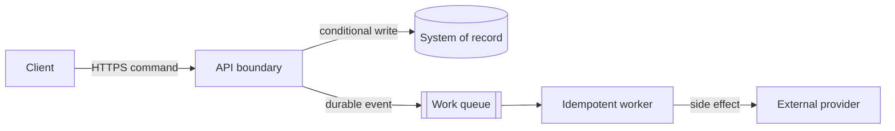

# Deliverables and diagrams

> Choose the smallest artifact that records the decision and unblocks execution. Respect requested formats.

## Full architecture document or RFC

Use when a design spans multiple boundaries, teams, interfaces, or quality attributes.

1. **Summary and decision:** business outcome, selected architecture, urgency.
2. **Context:** actors, baseline, constraints, scope, non-goals.
3. **Facts, assumptions, and unknowns:** evidence status and validation owner.
4. **Requirements:** prioritized journeys, invariants, SLI/SLO, RTO/RPO, security, cost envelope.
5. **Demand model:** auditable low/base/high math and architecture thresholds.
6. **Proposed architecture:** boundaries, authoritative owners, container view, read/write paths.
7. **Contracts and data:** APIs/events, schemas, consistency, idempotency, reconciliation, retention, deletion.
8. **Alternatives:** credible options (including simple baseline), downsides, reconsideration triggers.
9. **Production readiness:** overload, partial failure, recovery, observability, security/abuse, capacity, unit cost.
10. **Delivery and migration:** slices, mixed-version compatibility, rollout phases, abort thresholds, rollback, decommission.
11. **Validation and risks:** concrete fault schedules, pass/fail business oracles, launch gates, residual risks, owners.

Collapse immaterial sections to one line; keep decision-changing unknowns explicit.

## Architecture Decision Record

Use for one durable choice (`narrow-adr`). Present the decision and its five operational guarantees at a glance:

```markdown
# ADR-NNN: Decision title

- Status: proposed | accepted | superseded | deprecated
- Date: YYYY-MM-DD | Owners: roles or teams

## Context and drivers
Decision pressure, baseline constraint, and prioritized evaluation criteria.

## Considered options
1. Simple baseline / current architecture
2. Chosen option (and credible contenders, with rejection evidence)

## Decision and operational guarantees
Chosen mechanism, enforcement boundary, and five guarantees at a glance:
- **Latency and isolation:** sync/async boundary, tail-latency impact, and tenant or failure-domain isolation.
- **Visible completion:** durable business state guaranteed on caller success versus async completion.
- **Retry safety:** idempotency identity, deduplication scope, ambiguous-outcome resolution, and repair owner on exhaustion.
- **Cost drivers:** dominant variable units (requests, compute, storage/replicas, queue ops, transfer/egress).
- **Accepted downsides:** explicit trade-offs and operational load.

## Validation and reconsideration triggers
- **Verification:** concrete fault schedule and pass/fail business oracle.
- **Reconsideration triggers (label unsupplied numbers as Proposed):** quantitative thresholds—QPS/write rate, oldest uncompleted backlog age, error/conflict ratio, or unit cost—that require revisiting this choice.
```

Never hide unresolved correctness gaps in an ADR. Link superseding ADRs instead of rewriting history.

## Architecture review

Lead with verdict and scope. Order findings by severity: **priority, evidence, trigger, impact, recommendation, and pass/fail validation oracle**. Close with strengths to preserve, blockers, and open unknowns. Separate demonstrated defects from hypotheses.

## Migration plan

State source and target states, invariants held throughout cutover, mixed-version read/write compatibility, and source-of-truth handoff. Use a phase table: **slice, preconditions, cohort, success oracle, observation window, quantitative abort threshold (labeled if proposed), rollback, owner, and exit evidence**. Close with reconciliation and decommission gates.

## Implementation-ready plan

Group work into dependency-ordered vertical slices stating outcome, contract/data boundary, prerequisites, fault/invariant verification, rollout, and rollback. Leave code choices open only when contracts, invariants, migration safety, and operations are unaffected.

## Diagrams

Add a diagram only when topology, trust boundaries, or sequence are clearer visually than in prose. Pick the smallest view following the [C4 model](https://c4model.com/diagrams) intent:

- **System context:** actors and external systems.
- **Container:** deployable runtimes, authoritative stores, queues, and protocols.
- **Dynamic/sequence:** ordering, retries, lease handoff, or failure behavior for one journey.
- **Deployment:** regions/zones, trust boundaries, and failover when placement affects the decision.

### Mermaid rules

- Label every node with its role, not only a product name.
- Label edges with protocol, direction, and sync/async or conditional-write semantics.
- Distinguish authoritative stores, queues, trust boundaries, and external providers.
- Keep one story per diagram; state in prose what it omits.
- Fall back to an ordered flow or compact ASCII if Mermaid is unsupported. **A diagram never substitutes for consistency, failure, or ownership semantics.**


