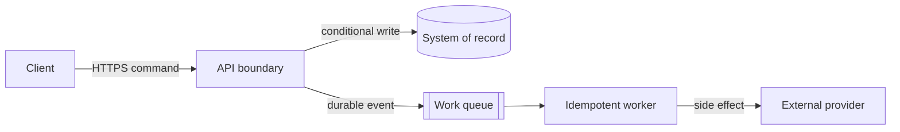

# Deliverables and diagrams

> Use the smallest artifact that records the decision and enables its next audience. Preserve requested formats when the user provides one.

## Full architecture document or RFC

Use for a system or change with several boundaries, interfaces, teams, or quality attributes.

1. **Summary and decision:** business outcome, selected direction, and why now.
2. **Context:** actors, current state, constraints, scope, and non-goals.
3. **Facts, assumptions, and open questions:** confidence and validation owner for material unknowns.
4. **Requirements:** prioritized journeys, invariants, SLI/SLO, recovery, security, and cost constraints.
5. **Demand model:** auditable low/base/high calculations and architecture thresholds.
6. **Proposed architecture:** boundaries, ownership, context/container view, and end-to-end read/write flows.
7. **Contracts and data:** APIs/events, source of truth, schemas, consistency, idempotency, retention, and deletion.
8. **Decisions and alternatives:** credible options, evaluation criteria, accepted downsides, and reconsideration triggers.
9. **Production behavior:** overload, partial failure, recovery, observability, security/privacy/abuse, capacity, and cost.
10. **Delivery:** implementation slices, compatibility, migration, rollout, rollback, and decommission.
11. **Validation and risks:** tests, experiments, launch gates, residual risks, owners, and unresolved decisions.

Tailor the sections. A section may be one sentence when the issue is immaterial; critical unknowns must remain visible.

## Architecture Decision Record

Use for one durable choice.

```markdown
# ADR-NNN: Decision title

- Status: proposed | accepted | superseded | deprecated
- Date: YYYY-MM-DD
- Owners: roles or teams

## Context
Decision pressure, requirements, constraints, and evidence.

## Decision drivers
Prioritized criteria that distinguish the options.

## Considered options
Credible alternatives, including retaining the current/simple approach when viable.

## Decision
Chosen option, scope, and key mechanics.

## Consequences
Benefits, accepted downsides, risks, operational effects, and migration impact.

## Validation and reconsideration
Evidence to collect and measurable triggers for revisiting the decision.
```

Do not use an ADR to hide unresolved requirements. Link superseding decisions rather than rewriting history.

## Architecture review

Lead with the verdict and review scope. List findings in priority order using: priority, evidence, trigger, impact, recommendation, and validation. End with strengths to preserve, blockers, follow-ups, and unknowns. Do not mix unproven hypotheses with demonstrated defects.

## Migration plan

Describe current and target states, throughout-migration invariants, compatibility model, and source-of-truth transitions. Use a phase table with change, preconditions, cohort, success metrics, observation window, abort threshold, rollback, owner, and exit evidence. Finish with reconciliation and decommission criteria.

## Implementation-ready plan

Group work into dependency-aware vertical slices. Each item states intended outcome, affected interface/data boundary, prerequisites, verification, rollout, and rollback. Leave code-level choices open only when they do not affect a public contract, invariant, migration, or operational risk.

## Diagrams

Use diagrams only when relationships, hierarchy, placement, or sequence are harder to understand in prose.

Choose the smallest useful view:

- **System context:** people and external systems around the system under design.
- **Container:** independently deployable or managed runtime/data boundaries and their protocols.
- **Dynamic/sequence:** ordering, retries, asynchronous transitions, or failure behavior for one journey.
- **Deployment:** regions/zones, placement, network/trust boundaries, and failover when these affect a decision.

System context and container views are sufficient for most architecture discussions. Add component or deployment detail only for the specific risk under review.

### Mermaid rules

- Give every node a descriptive role, not only a product name.
- Label important edges with protocol, direction, and sync/async semantics.
- Show authoritative stores, queues, trust boundaries, and external actors distinctly.
- Keep one diagram to one story. Split a crowded picture.
- Explain the diagram in prose, including what it intentionally omits.
- Avoid syntax that depends on experimental Mermaid features.

Example container-level flow:



If the target cannot render Mermaid, provide an equivalent ordered flow or compact ASCII diagram. **A diagram never substitutes for consistency, failure, or ownership semantics.**

This diagram guidance follows the notation-independent intent of the [C4 model](https://c4model.com/diagrams) without requiring a C4-specific tool.
